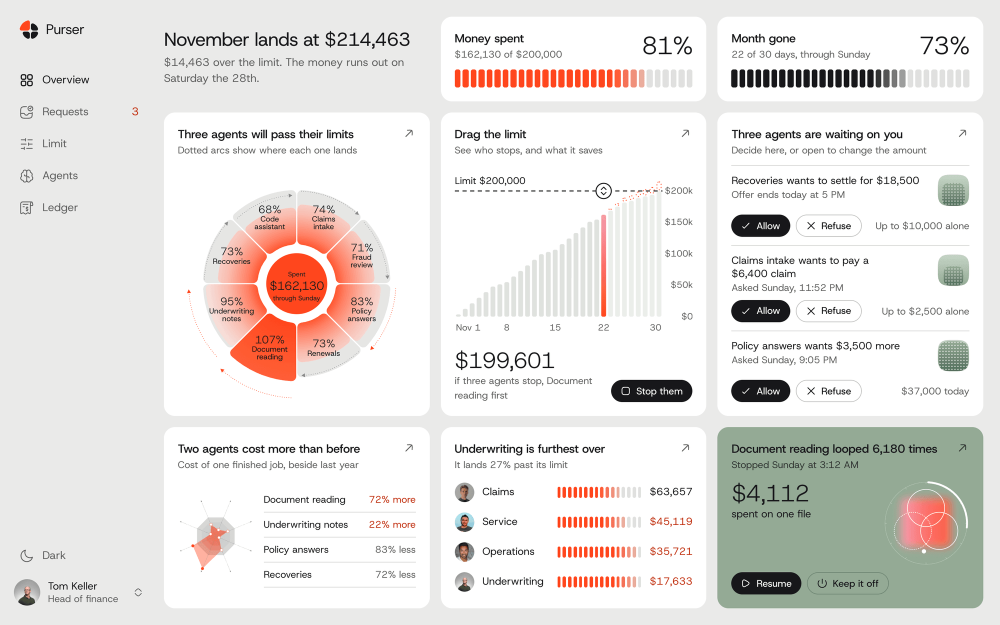

# Purser

**AI agent spend control.** See what a company's AI agents spend, limit it, and decide what they may do without asking.

**[Open the live demo](https://purser-panzestudio-agent-spend-control.vercel.app)**

<picture>
  <source media="(prefers-color-scheme: dark)" srcset="docs/overview-dark.png">
  
</picture>

## The idea

A ship's purser holds the money and keeps the crew's accounts. Here the crew is a company's AI agents.

Agents now spend money and act on their own, and most companies find out afterwards. Purser is for the person who answers for that spend. It opens with three answers:

1. Will we stay inside this month's money?
2. What is waiting for my decision?
3. Which agents are worth what they cost?

## What it does

- **Overview.** Every answer on one desktop screen, from where the month lands to the agent that went in circles on Sunday.
- **Limit.** Drag the limit and the forecast redraws. It names who stops, when, and how much work is left undone.
- **Requests.** Agents ask to go past their authority. Allow the amount, allow less, or refuse and see what happens instead.
- **Agents.** The cost of one finished job beside what that job cost before. Two of the eight cost more, and the screen says so.
- **Ledger.** Spend by team and agent, down to a single run.

Every decision changes the numbers on the other pages and can be undone. To start over, open the account menu and choose **Undo everything you decided**.

## Design

- **Color has meaning.** Hot orange is money spent and sage is authority.
- **Two themes.** Light, and a warm dark one designed for its own canvas. The theme follows the system until you pick one.
- **One grid.** Three columns on a desktop, two on a tablet, one on a phone, where the app has its own tab bar and bottom sheets.
- **Flat.** Surfaces separate by lightness alone, with no shadows.
- **Made by hand.** The charts are hand-drawn SVG, with no chart library and no UI kit.

More in the [concept brief](docs/brief.md) and the [design direction](docs/design-direction.md).

## Run it

Needs Node 20.9 or newer.

```bash
npm install
npm run dev
```

Then open [localhost:3252](http://localhost:3252). `npm run check` runs the types and a production build.

## Built with

Next.js 16, React 19, TypeScript, [StyleX](https://stylexjs.com), [Hugeicons](https://hugeicons.com) and Host Grotesk.

| Where | What |
| --- | --- |
| `src/lib/data.ts` | The invented company: agents, teams, requests and runs |
| `src/lib/model.ts` | The forecast, and which agents stop to stay under a limit |
| `src/lib/store.tsx` | Decisions and undo |
| `src/styles` | Color tokens, spacing and the dark theme |
| `src/components` | The screen, one file per block |

## About

A portfolio concept designed and built by [Rakibul Islam](https://rakibulism.space). The company, people, agents and numbers are invented, and every total adds up from the rows beneath it.
